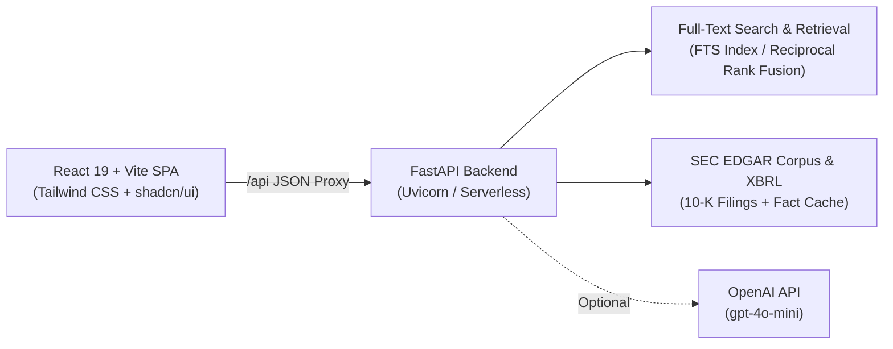

# 📊 Document Copilot

[](LICENSE)
[](https://www.python.org/)
[](https://fastapi.tiangolo.com/)
[](https://react.dev/)
[](https://www.typescriptlang.org/)
[](https://tailwindcss.com/)
[](https://vercel.com/)

**Document Copilot** is a high-precision, production-grade financial research desk designed for investment analysts, equity researchers, and portfolio managers. It ingests official SEC EDGAR 10-K annual reports across major enterprises (Apple, Microsoft, NVIDIA, Amazon, Alphabet) and provides grounded, factual answers with clickable sentence-level citations and interactive XBRL financial metrics.

---

## 🌟 Key Highlights & Capabilities

- 🔍 **Strictly Grounded Retrieval (Zero Hallucinations):** Every synthesized answer or extracted fact is strictly bound to source 10-K passages. If evidence is not in the filings, the copilot explicitly refuses rather than guessing.
- 📑 **Item-Level Filing Coverage:** Deep indexing over **Item 1** (Business Summary), **Item 1A** (Risk Factors), and **Item 7** (Management's Discussion & Analysis — MD&A).
- 📈 **SEC XBRL Financial Intelligence:** Automatically renders year-over-year financials (Revenue, Net Income, Operating Income, Diluted EPS, Cash & Equivalents, Debt) directly extracted from SEC XBRL disclosures with percentage changes and accession links.
- ⚡ **Dual Inference Modes:**
  - **Local Extractive Mode:** Runs completely offline with zero API keys or external subscriptions required.
  - **AI Synthesized Mode:** Powered by OpenAI (`gpt-4o-mini`) to write cited, context-aware prose over the retrieved excerpts.
- 🌐 **Instant Multi-Company Comparison:** Side-by-side comparative analysis of key strategic risks, revenue drivers, and supply chain constraints across peers.
- 🚀 **Serverless Cloud Ready:** Pre-configured with serverless handlers (`api/index.py`), SQLite in `/tmp`, and reverse proxies for turnkey 1-click deployment on **Vercel**.

---

## 🛠️ Tech Stack & Architecture



### **Frontend**
- **Framework:** React 19 + TypeScript (Strict Mode)
- **Bundler & Tooling:** Vite, Rolldown native bindings
- **Styling & UI:** Tailwind CSS v4, shadcn/ui primitives, Lucide Icons, `@base-ui/react`
- **Typography:** Geist Variable (primary text), Fraunces (financial serif wordmark)
- **Routing & Networking:** React Router v7, Native typed HTTP Client

### **Backend**
- **Framework:** Python 3.12+ with FastAPI + Uvicorn
- **Validation & Settings:** Pydantic v2 & `pydantic-settings`
- **Data & Storage:** SQLAlchemy 2.0 with SQLite FTS (Postgres / Supabase `pgvector` compatible)
- **Retrieval Engine:** BM25 / Full-text retrieval fused with Reciprocal Rank Fusion (RRF)
- **Logging:** Structured JSON / Console logging via `structlog`
- **Package Management:** `uv` & pinned `pip` requirements

---

## 📂 Repository Structure

```text
Gen-Ai-Project/
├── backend/
│   ├── app/
│   │   ├── analysis/       # Financial metrics & company comparison logic
│   │   ├── api/            # FastAPI routes (auth, chat, desk, health)
│   │   ├── auth/           # Session management & token issuance
│   │   ├── chat/           # Turn orchestration & answer grounding
│   │   ├── corpus/         # Pre-indexed SEC 10-K seeds & XBRL financial facts
│   │   ├── database/       # SQLAlchemy schema, SQLite session & models
│   │   ├── grounding/      # Citation validator & evidence check
│   │   └── retrieval/      # Full-text retriever & fusion ranking
│   └── requirements.txt    # Pinned Python dependencies
├── frontend/
│   ├── api/                # Vercel serverless Python entrypoint (index.py)
│   ├── src/
│   │   ├── components/     # Chat, Desk, SourceSheet, & shadcn UI components
│   │   ├── pages/          # ChatPage and LoginPage
│   │   └── lib/            # Typed API client, session store, environment
│   ├── package.json        # Frontend scripts and packages
│   └── vite.config.ts      # Reverse proxy to backend
├── data/                   # SEC EDGAR automated download pipeline
├── docs/                   # Architecture specs, client briefs, and setup guides
└── vercel.json             # Vercel routing, rewrite, and serverless config
```

---

## 🚀 Quickstart & Local Setup

### 1. Prerequisites
- **Python 3.12+**
- **Node.js 20+** & **pnpm** (`corepack enable && corepack prepare pnpm@latest --activate`)

### 2. Backend Setup
```bash
# Navigate to backend
cd backend

# Create virtual environment and install packages
python3 -m venv .venv
source .venv/bin/activate
pip install -r requirements.txt

# Create local environment file
cp .env.example .env

# Run FastAPI backend
uvicorn app.main:app --host 0.0.0.0 --port 43124 --reload
```
The API will be available at `http://127.0.0.1:43124`. Verify with `curl http://127.0.0.1:43124/health`.

### 3. Frontend Setup
In a new terminal window:
```bash
# Navigate to frontend
cd frontend

# Install dependencies
pnpm install

# Create frontend environment file
cp .env.example .env

# Start Vite development server
pnpm dev
```
Open **[http://localhost:43123](http://localhost:43123)** in your browser. You can sign in using any email (e.g. `analyst@driftwood.example`).

---

## ⚙️ Environment Configuration

Both `backend/.env` and `frontend/.env` configure how the application runs:

### Backend (`backend/.env`)
```ini
# Core Configuration
DATABASE_URL=sqlite:///./document_copilot.db
AUTH_MODE=local
LOCAL_AUTH_SECRET=your-random-32-char-secret-string
SEED_ON_STARTUP=true
ALLOWED_ORIGINS=http://127.0.0.1:43123,http://localhost:43123

# Optional: Enable OpenAI dynamic answer generation (Default: Extractive local mode)
OPENAI_API_KEY=sk-your-openai-api-key
OPENAI_MODEL=gpt-4o-mini
```

### Frontend (`frontend/.env`)
```ini
VITE_API_BASE_URL=/api
VITE_AUTH_MODE=local
```

---

## ☁️ Deployment on Vercel

The project includes custom Vercel configuration for seamless deployment:

1. Push your repository to GitHub.
2. In [Vercel](https://vercel.com), click **Add New... → Project** and import `SiddharthaShukla8/Gen-Ai-Project`.
3. Set **Root Directory** to `frontend`.
4. Ensure **Framework Preset** is set to `Vite`.
5. Add the following **Environment Variables**:
   - `AUTH_MODE` = `local`
   - `LOCAL_AUTH_SECRET` = `(generate any random 32+ character string)`
   - `SEED_ON_STARTUP` = `true`
   - `ALLOWED_ORIGINS` = `https://*.vercel.app`
   - `VITE_API_BASE_URL` = `/api`
   - `VITE_AUTH_MODE` = `local`
   - `OPENAI_API_KEY` = `(optional OpenAI key)`
6. Click **Deploy**. Vercel will build the React SPA and launch the serverless Python backend automatically.

---

## 📄 License

This project is licensed under the [MIT License](LICENSE).
